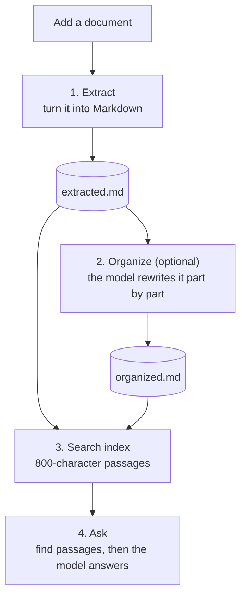
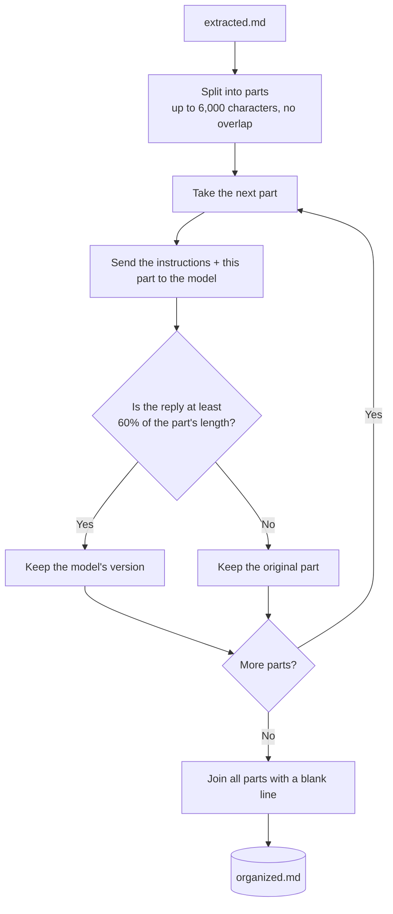

# How the code works

This guide follows a document through the app, from upload to answer. It explains in detail how the model receives chunks to reorganize text.

To install or start the app, see [README.md](README.md).

---

## The workflow at a glance



| Step | What happens | Main code |
|---|---|---|
| Add | The file is copied into the document's own folder | `backend/storage.py` |
| Extract | The file becomes Markdown text | `backend/extract.py` |
| Organize | The model restructures the text, one part at a time | `backend/organize.py` |
| Ask | Search finds the relevant passages, and the model answers from them | `backend/rag.py` |

The web app and the command line (`cli.py`) use the same backend code and the same saved files.

---

## The code files

| File | Job |
|---|---|
| `backend/api.py` | The web API that the web app calls. Streams progress to the browser |
| `backend/extract.py` | Reads documents with MarkItDown, the vision model, and Tesseract |
| `backend/organize.py` | Splits the text into parts and sends each one to the model |
| `backend/rag.py` | Search index, passage search, and answers |
| `backend/llm.py` | Everything that talks to Ollama |
| `backend/storage.py` | Saves and loads each document's files |
| `backend/settings.py` | Remembers the model you picked |
| `backend/config.py` | All the default settings |
| `cli.py` | The command-line version of the app |
| `web/` | The Next.js web app |

---

## The models

The app uses two kinds of model:

| Model | Default | Runs in | Used for |
|---|---|---|---|
| Chat model | `gemma3:12b`, or the one picked in the app | Ollama | Reading images, organizing text, answering questions |
| Embedding model | `BAAI/bge-base-en-v1.5` | The app itself, not Ollama | Turning passages into vectors for search |

---

## Step 1: Extract

`extract()` in `backend/extract.py` chooses the method based on the chat model:

| Situation | What reads the document |
|---|---|
| The model can read images | MarkItDown reads the structure, and the model reads images and scanned pages |
| The model can't read images, or isn't available | MarkItDown reads the structure and skips images inside documents. Tesseract reads scanned pages in PDFs, which are added at the end |
| MarkItDown finds no text or fails | Tesseract reads the whole file (PDFs and images only) |

The text is saved as `extracted.md`, along with a fingerprint of the original file. If the file changes later, the old results are discarded and the document is read again.

In the web app, extraction starts automatically after upload.

---

## Step 2: How the model reorganizes the text

This is the `reorganize()` function in `backend/organize.py`. It always starts from `extracted.md`, so **Organize again** never rewrites an earlier rewrite.

A long document can't fit in the model's context window, so the text is split and the model works on one part at a time.



### 1. Split the text into parts

The app uses LangChain's `RecursiveCharacterTextSplitter` with `chunk_size=6000` and `chunk_overlap=0`.

The splitter looks for the most natural place to cut, in this order:

1. Blank lines, which are paragraph breaks
2. Single line breaks
3. Spaces
4. Between any two characters, as a last resort

Short paragraphs are then packed together until the next one wouldn't fit. Because the overlap is 0, no text is repeated between parts.

**Example:** a text with 15 paragraphs of 1,000 characters each, 15,028 characters in total, splits like this:

| Part | Paragraphs | Length |
|---|---|---|
| 1 | 1 to 5 | 5,008 characters |
| 2 | 6 to 10 | 5,008 characters |
| 3 | 11 to 15 | 5,008 characters |

Each part stops at 5 paragraphs because a sixth would make it 6,010 characters, just over the limit.

### 2. Send one part to the model

The parts go to the model **one at a time, in order**. Each one is a brand-new conversation with two messages.

The system message is the same for every part:

> You're a Markdown organizer. Reorganize the content for clarity, structure, and readability. Do not delete or summarize any content. Preserve all original information exactly as-is, just improve its organization and Markdown formatting. Keep the original heading levels. Output only the reorganized Markdown, with no introduction, notes, or closing remarks.

The user message contains the part itself:

> Rewrite the following content in markdown format and fix it:
> *(the text of this part)*

**The model has no memory between parts.** While it works on part 2, it can't see part 1 or part 3, or what it wrote for them.

### 3. Check the reply

Each reply goes through one safety check:

```python
if len(organized) < config.MIN_KEPT_RATIO * len(chunk):
    organized = chunk
```

If the reply is shorter than 60% of the part, the model probably dropped content, so the app logs a warning and keeps the original part. For a 5,008-character part, any reply under about 3,005 characters is rejected.

### 4. Join and save

When every part is done, they're joined with a blank line and saved as `organized.md`. `extracted.md` is never changed, so you can always switch back to it.

The web app shows progress as each part starts. It works from the `done` and `total` counts sent by `on_progress`.

### Limits to keep in mind

| Limit | What it means for you |
|---|---|
| Parts are handled separately | A table or section that crosses a part boundary is formatted in two pieces, and styling can differ between parts |
| The check only measures length | A reply that is long enough can still have lost or changed details. Compare it with the extracted text when accuracy matters |
| Parts run one after another | Time grows with the document's length |
| Saving happens at the end | If a part fails, nothing new is saved, any earlier `organized.md` stays, and the next run starts again from part 1 |
| The limit counts characters, not tokens | Each part, the instructions, and the reply must all fit in `NUM_CTX`. Some text uses more tokens per character, so lower `ORGANIZE_CHUNK_CHARS` if replies get cut off |

---

## Step 3: Ask a question

Questions use **different, smaller chunks** from organizing, because search needs short and focused passages.

| | Organizing | Search |
|---|---|---|
| Purpose | Fit the text in the model's context window | Find the exact passages for a question |
| Chunk size | 6,000 characters | 800 characters |
| Overlap | None, so nothing is repeated in the output | 100 characters, so a sentence at a cut isn't lost |
| Which chunks reach the model | All of them, one at a time | Only the best matches, all together |

You choose whether to ask about the extracted or the organized text. Each has its own search index.

1. **Prepare the search.** The text is split into passages and the vector index is saved in `index_raw/` or `index_organized/`. It's reused until the text or embedding model changes. The keyword search is rebuilt whenever the document is loaded into memory.
2. **Search two ways.** Vector search finds passages with a similar meaning, and BM25 keyword search finds exact names, codes, and numbers. Each returns its top 4.
3. **Combine the results.** Each passage gets a score of `1 / (60 + rank)` from each search, with rank starting at 0, and the scores are added together. A passage found by both searches rises to the top. The best 6 at most are kept.
4. **Answer.** The passages are sent to the chat model with an instruction to use only that context, and to say so if the answer isn't there. The answer streams to the screen as it's written.
5. **Show the sources.** The web app receives each passage's position in the text, so it can highlight where the passage sits in the document.

---

## Where everything is saved

Each document gets its own folder in `outputs/`, or in the Docker volume when running in Docker:

```
outputs/
├── settings.json          the model you picked
└── report_pdf/
    ├── original.pdf       the uploaded copy (web app only)
    ├── meta.json          original filename and location
    ├── document.sha256    fingerprint of the document
    ├── extracted.md       text from step 1
    ├── organized.md       text from step 2
    ├── index_raw/         search index for extracted.md
    └── index_organized/   search index for organized.md
```

---

## Settings that change this behavior

They're all in `backend/config.py`.

| Setting | Default | What it controls | Change with |
|---|---|---|---|
| `ORGANIZE_CHUNK_CHARS` | 6000 | Maximum size of each part sent for organizing | Environment variable |
| `NUM_CTX` | 8192 | How many tokens the model can handle at once | Environment variable |
| `MIN_KEPT_RATIO` | 0.6 | Replies shorter than this fraction of the part are rejected | Editing the code |
| `SEARCH_CHUNK_CHARS` | 800 | Size of each search passage | Editing the code |
| `SEARCH_CHUNK_OVERLAP` | 100 | Characters shared between neighboring passages | Editing the code |
| `TOP_K` | 4 | Passages taken from each search. Up to `TOP_K + 2` reach the model | Environment variable |
| `OLLAMA_MODEL` | `gemma3:12b` | Chat model used until you pick one in the app | Environment variable |
| `EMBED_MODEL` | `BAAI/bge-base-en-v1.5` | Embedding model for search | Environment variable |
